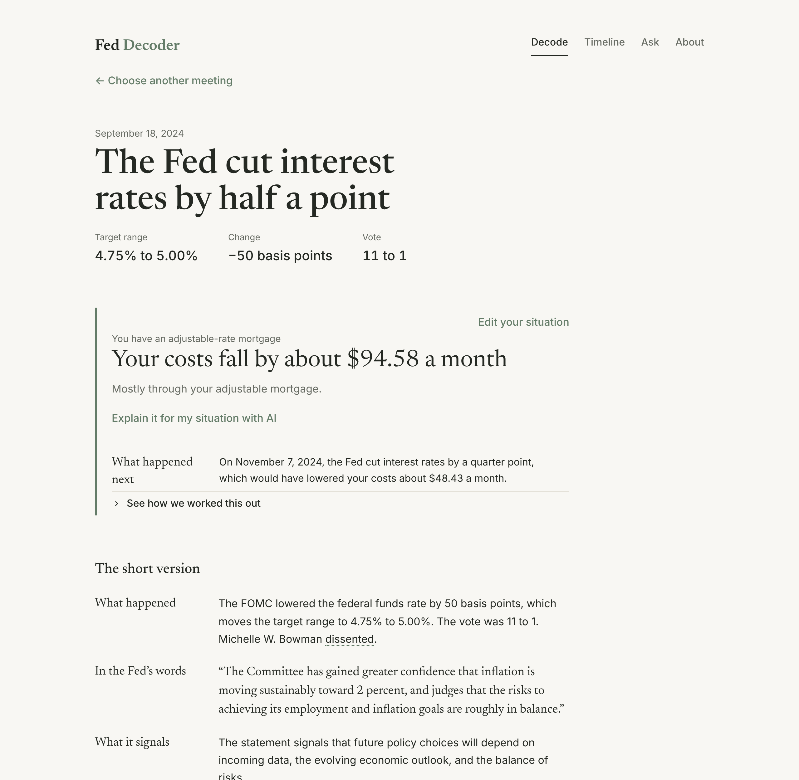

# Fed Decoder

Federal Reserve decisions in plain English. Pick any FOMC meeting since 2000 (or paste a statement) and get the decision, a redline against the previous statement, a hawkish-to-dovish tone reading with the quotes behind it, what it means for borrowers, savers and workers, what it means for the economy, and a light, backtested forecast of the next move.



**Live app:** _deploy link goes here once published on Streamlit Community Cloud (see [Deploy](#deploy-free))._

## What it does

- **Decode a meeting.** 227 statements, February 2000 to October 2026, each with a pre-built decoder card (`cards/`). Viewing a past meeting makes zero API calls.
  - *Decision:* direction, size in basis points, target range, vote, dissenters.
  - *What changed:* a word-level redline against the previous statement. Deletions are struck, additions highlighted, and hovering a change shows what it means.
  - *Tone:* a dial from dove (−2) to hawk (+2), with the sentences that drive it.
  - *For you:* one sentence and one computed number each for borrowers, mortgages, savers and workers. The mortgage card says that mortgages track the 10-year Treasury, not fed funds.
  - *For the country:* inflation, jobs, growth, markets and the dollar, from FRED.
  - *What's next:* model probabilities for hold, cut or hike, shown next to the backtest against a "no change" baseline.
- **Ask.** Chat with tools over the corpus and the data: `get_meeting`, `search_statements` (TF-IDF), `diff_statements`, `get_series`, `payment_impact` and `forecast_next`. Every number in an answer is checked against the tool results.
- **Timeline.** The fed funds target since 2000, with every meeting as a dot colored by tone. Click a dot to decode that meeting.

## Three findings

1. **Mortgages don't follow the Fed on decision day.** On the 75 days since 2000 when the Fed moved rates, the 10-year Treasury moved in the same direction only 41% of the time. Its median move was 4 bp against a median policy move of 25 bp. The 2-year, the most Fed-sensitive market rate, matched the direction 56% of the time. Markets usually price the move in before the meeting, which is why the mortgage card points to the 10-year.
2. **A small model beats "no change", but only on accuracy.** The walk-forward logistic forecast (Taylor-rule gap, SEP gap, statement tone, momentum) calls the next decision right 77% of the time, against 70% for always predicting "no change". It gets the direction right on 64% of the meetings where the Fed actually moved. A class-balanced version catches more moves (80%) but loses to the baseline overall (65%), so it was dropped.
3. **Dissents carry signal.** Dictionary tone correlates with the next meeting's rate change (Spearman 0.42). Leaving dissenters' stated preferences out of the tone score, so the dial reflects only the Committee's words, *lowers* that correlation slightly (0.438 to 0.423). An explicit "dissent lean" feature did not improve the forecast either (75% vs 77%), so the extra signal is real but small.

## How it runs for $0

| Piece | Free service | How we stay inside the limits |
|---|---|---|
| LLM, primary | Google Gemini API, Flash models, free tier (AI Studio key, no card) | 8 requests/min limiter, rotation across Flash models on 503 or a spent daily quota, then fall back |
| LLM, fallback | Groq free tier, `openai/gpt-oss-120b` | Token-per-minute budget under the 8,000 TPM cap |
| LLM, last resort | Rules-based mode (regex, difflib, dictionary tone, templates) | No API, always available |
| Decoder cards | Pre-generated once by `scripts/build_cards.py` (about 230 calls, resumable) | Viewing a meeting makes zero calls |
| Chat | Live | Answer cache, 10 questions per session, a global daily counter that switches to cached and rules-based answers at 90% of `DAILY_LLM_BUDGET` (default 80), history kept to the last 4 turns |
| Data | federalreserve.gov and FRED (public CSV endpoint, no key needed) | Polite scraper (1 s delay, cached HTML) |
| Refresh | GitHub Actions, scheduled after each meeting | Incremental fetch; at most 10 new cards per run |
| Hosting | Streamlit Community Cloud | Keys in Streamlit secrets |

Never enable billing on either provider. Model IDs and rate settings live in `fed_decoder/config.py` and can be overridden with environment variables (`GEMINI_MODEL`, `GROQ_MODEL`, `GEMINI_RPM`, `GROQ_RPM`, `DAILY_LLM_BUDGET`). Free-tier limits change, so check them in each console before deploying.

**Privacy.** Gemini's free tier may use inputs to improve Google's models, so the app sends only public text: Fed statements, data, and questions about the Fed. The Ask page and the paste box both say "Don't enter personal information."

## Design rules

- **Numbers come from code.** Rates, dates, votes, payments, forecasts and statistics are computed in Python. The displayed decision always comes from the ground truth. The model's own extraction is stored separately (`llm_decision`) and used only for evals.
- **Every claim is grounded.** Any number in LLM output that isn't in the context or tool results fails the guardrail (`fed_decoder/llm/guardrail.py`). A failure gets one retry with the error fed back; if the retry also fails, the app shows the rules-based text. Quotes must appear verbatim in the statement.
- **Graceful degradation.** Gemini, then Groq, then rules. Users never see an error. A subtle label shows who answered ("Answered by Gemini Flash", "Automated summary (rules-based)").
- **Scope.** The chat refuses personal investment advice and off-topic questions. Pasted text is fenced as data, and the system prompt says to ignore instructions inside it.

## Status of the LLM parts

- **Cards:** all 227 meetings have a validated Gemini-written card. Most come from `gemini-3.5-flash-lite`, which had by far the largest free daily quota; a few come from `gemini-3.5-flash`, `gemini-3.6-flash`, `gemini-3-flash-preview` and `gemini-flash-lite-latest`. Each card records its model. The displayed decision numbers are always the code-computed ones.
- **Live chat:** verified against the live Gemini API, including multi-turn function calling (Gemini 3 thought signatures are replayed).
- **Groq:** verified live (strict JSON-schema output and tool calls), but its free tier caps `gpt-oss-120b` at 8,000 tokens per minute and **200,000 tokens per day**, about 30 decoder cards a day. Groq rows in the report are therefore partial; rerun `python evals/run.py` on a later day to fill them in (successful outputs are cached in `evals/runs/`, so nothing is spent twice).
- **Hand labels pending:** fill `evals/hand_labels_tone.csv` (30 statements) and `evals/hand_labels_claims.csv` (20 claims), then rerun the evals.
- **In-sample caveat:** the regex extractor and the chat scope check were fixed against the same meetings and questions they are scored on, so their 100% means "no known misses", not a generalization estimate. Rules-based vote and dissenter accuracy is also not independent of the answer key, because both use the same vote parser.

### Free-tier limits we hit (checked November 2026)

| Provider | Limit that binds | What the app does |
|---|---|---|
| Gemini | 20 requests per day **per model** for the Flash models (Flash-Lite allows far more); 503 "high demand" comes and goes | Tries `gemini-3.5-flash`, then `3.6-flash`, `3-flash-preview`, `3.5-flash-lite`, `flash-lite-latest`; a model out of daily quota is skipped until midnight Pacific |
| Groq `gpt-oss-120b` | 8,000 tokens/min, 200,000 tokens/day, 1,000 requests/day | Sliding token-per-minute budget, low reasoning effort |
| Both | | App-wide daily chat budget (`DAILY_LLM_BUDGET`, default 80 calls) before switching to cached and rules-based answers |

`gemini-2.5-flash` is closed to new API users, so it is no longer the default.

To rebuild cards with your own keys:

```bash
cp .env.example .env
```

Add free-tier keys to `.env`, then:

```bash
python scripts/build_cards.py
```

It stops when every provider is out of quota and resumes on the next run.

## Data

| File | Contents | Source |
|---|---|---|
| `data/statements.parquet` | `meeting_date, statement_text, url` for 227 statements (scheduled and unscheduled) | federalreserve.gov calendars and historical pages |
| `data/ground_truth.parquet` | Decision, size, range, votes, dissenters per meeting (the eval answer key) | FRED target series for decisions; vote paragraph parsed in code |
| `data/fred.parquet` | 18 series: target bounds, EFFR, CPI, core PCE, unemployment, payrolls, 2y/10y, 30y mortgage, credit card, auto loan, SEP median, GDP, potential GDP, dollar, S&P 500 | FRED (every ID verified on download) |
| `data/sep_vintages.parquet` | SEP median fed funds path as published at each meeting since December 2015 | ALFRED vintages (no look-ahead) |
| `data/forecast_backtest.parquet` | Walk-forward predictions | computed |

Monthly and quarterly data are lagged by about one release when describing "the data at the time" of a meeting.

**Forecast details.** The Taylor rule is the Taylor (1993) variant: `i* = r* + π + 0.5(π − 2) + 0.5·gap`, with r* = 2.0, π = core PCE year over year, and gap = CBO output gap from `GDPC1`/`GDPPOT`. The SEP gap is the SEP median for the relevant year-end minus the current midpoint, set to 0 with a flag before 2016. The model is multinomial logistic regression with scikit-learn defaults. In the walk-forward backtest, each prediction is trained only on meetings whose outcome was already known. It is educational, not financial advice.

## Run locally

```bash
pip install -r requirements.txt
```

```bash
streamlit run app.py
```

Rebuild everything from scratch:

```bash
python scripts/fetch_statements.py && python scripts/fetch_fred.py && python scripts/build_data.py && python scripts/build_cards.py
```

Tests and evals:

```bash
python -m pytest -q tests
```

```bash
python evals/run.py
```

## Deploy (free)

1. Push this repo to GitHub (public).
2. On [share.streamlit.io](https://share.streamlit.io), create an app from the repo with main file `app.py`.
3. In the app's **Settings → Secrets**, add:
   ```toml
   GEMINI_API_KEY = "..."
   GROQ_API_KEY = "..."
   ```
4. In the GitHub repo's **Settings → Secrets and variables → Actions**, add the same keys so the refresh workflow can build cards for new meetings.

The app works with no keys at all: every page then runs in rules-based mode.

## Layout

```
app.py                     Streamlit app (Decode / Ask / Timeline)
fed_decoder/
  config.py                model names, limits, series IDs
  data/                    scraper, FRED client, ground truth, Parquet access
  analysis/                diff, tone dictionary, impact math, forecast, search
  llm/                     generate() interface, Gemini + Groq providers, router, guardrails
  cards/                   schema, context builder, LLM builder, rules builder, store
  chat/                    tools and agent (scope, cache, quota, fallback)
  ui/                      theme and components (redline, tone dial, cards, timeline)
scripts/                   fetch_statements, fetch_fred, build_data, build_cards
evals/                     run.py, chat questions, hand-label templates, report.md
tests/                     unit tests and fake-provider tests for the LLM paths
```

## Eval report

<!-- EVAL-REPORT:START -->
Generated 2026-11-04 09:33 UTC. Keys available: Gemini=yes, Groq=yes. Cards in `cards/`: {'gemini': 227}.

### 1. Extraction vs ground truth

Ground truth: decision and range from FRED target series; votes and dissenters parsed from each statement's voting paragraph.

| Extractor | Meetings | Direction | Size (bp) | Target range | Vote count | Dissenters |
|---|---|---|---|---|---|---|
| Rules-based (regex) | 227 | 100.0% | 100.0% | 98.7% | 100.0% | 100.0% |
| LLM cards | 227 | 100.0% | 100.0% | 100.0% | 100.0% | 100.0% |

Vote and dissenter accuracy for the rules extractor is not independent: it uses the same vote parser that builds the answer key. Range misses are statements that state no target (liquidity or balance-sheet announcements).

### 2. Tone validity

| Check | Result |
|---|---|
| Dictionary tone vs next meeting's rate change | Pearson 0.45, Spearman 0.42 (n=226) |
| LLM card tone vs next meeting's rate change | Pearson 0.59, Spearman 0.58 (n=226) |
| Agreement with hand labels (30 statements) | pending: fill `evals/hand_labels_tone.csv` |
| Gemini vs Groq | Pearson 0.97, mean abs diff 0.58, within 0.5: 66.7% (n=6) |
| LLM vs dictionary model | Pearson 0.70, sign agreement 63.4% (n=227) |

### 3. Consistency (20 statements x 3 runs)

- Dictionary model: deterministic, spread 0.00 on 20 statements.
- LLM: mean range 0.28, max range 1.00, mean std 0.13, identical across runs 50.0% (n=20, temperature 0.7)

### 4. Grounding

| Cards | n | Number check pass | Quote check pass |
|---|---|---|---|
| llm | 227 | 100.0% | 100.0% |
| rules | 0 | n/a | n/a |

LLM judge (Groq judging Gemini claims): 100.0% of 3 sampled claims supported; hand-label validation pending (`evals/hand_labels_claims.csv`)

### 5. Impact math

400 cases (mortgage, auto, HELOC, credit card across balances, rates and moves) vs an independent closed-form amortization: max absolute error $0.0000. Exact to the cent: yes.

### 6. Forecast backtest

Walk-forward, 2004-09-21 to 2026-09-16, 186 meetings.

| Model | Hit rate |
|---|---|
| Logistic (Taylor gap, SEP gap, tone, momentum) | 76.9% |
| Baseline: always "no change" | 69.9% |

The model beats the baseline. On meetings where the Fed actually moved, the model called the direction 64.3% of the time (the baseline gets 0% of those).

### 7. Chat (30 known-answer questions, 10 adversarial)

| Mode | Accuracy | Adversarial pass | Mean latency | Fell back to rules |
|---|---|---|---|---|
| rules | 100.0% | 100.0% | 0.07s | n/a |
| gemini | 93.3% | 100.0% | 15.04s | 10.0% |
| groq | 100.0% | 100.0% | 39.05s | 100.0% |

### 8. Provider comparison

| Provider | n | Direction | Size | Range | Votes | Grounding pass | Mean latency | Fell back |
|---|---|---|---|---|---|---|---|---|
| gemini | 20 | 100.0% | 100.0% | 100.0% | 100.0% | 100.0% | 31.00s | 0.0% |
| groq | 20 | 100.0% | 100.0% | 100.0% | 100.0% | 80.0% | 100.39s | 75.0% |
| rules | 20 | 100.0% | 100.0% | 100.0% | 100.0% | 100.0% | 0.00s | 0.0% |

Logged LLM calls this far: 638 ok ({'gemini': 552, 'groq': 86}), fallback share 0.0%, 221 rate-limit events, 43 guardrail failures.


### Before / after

**Rules extractor: pick the action sentence, accept spaced fractions ("1 3/4"), infer direction from a changed range.** Before = commit `e670b22`, scored on the same 227 meetings.

| Version | Direction | Size (bp) | Target range |
|---|---|---|---|
| Before | 98.7% | 97.8% | 85.5% |
| After | 100.0% | 100.0% | 98.7% |

**Rules baseline: drop the voting paragraph before tone scoring** (dissenters' reasons, e.g. "preferred to lower the target range", were being scored as the Committee's tone).

| Version | Spearman vs next rate change | Pearson |
|---|---|---|
| Before (whole statement) | 0.438 | 0.462 |
| After (voting paragraph excluded) | 0.423 | 0.453 |

This change made the predictive correlation slightly *worse*: dissenters' stated preferences carry information about the next move. It is kept because the tone quotes shown to users must be the Committee's own words, not a dissenter's.

**LLM cards: add the code-computed diff to the card inputs.**

| Version | Cards | Change-quote precision | Validation pass |
|---|---|---|---|
| before_no_diff | 19 | 83.3% | 100.0% |
| after_with_diff | 20 | 100.0% | 100.0% |
<!-- EVAL-REPORT:END -->

---

Not financial advice. Data: Federal Reserve, FRED. AI: Gemini / Groq free tiers.
