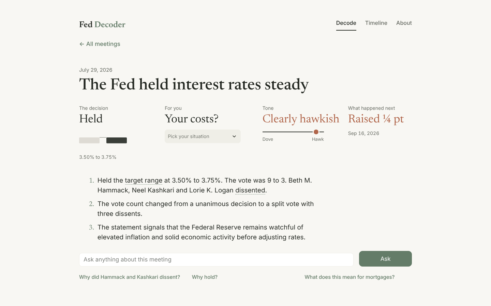
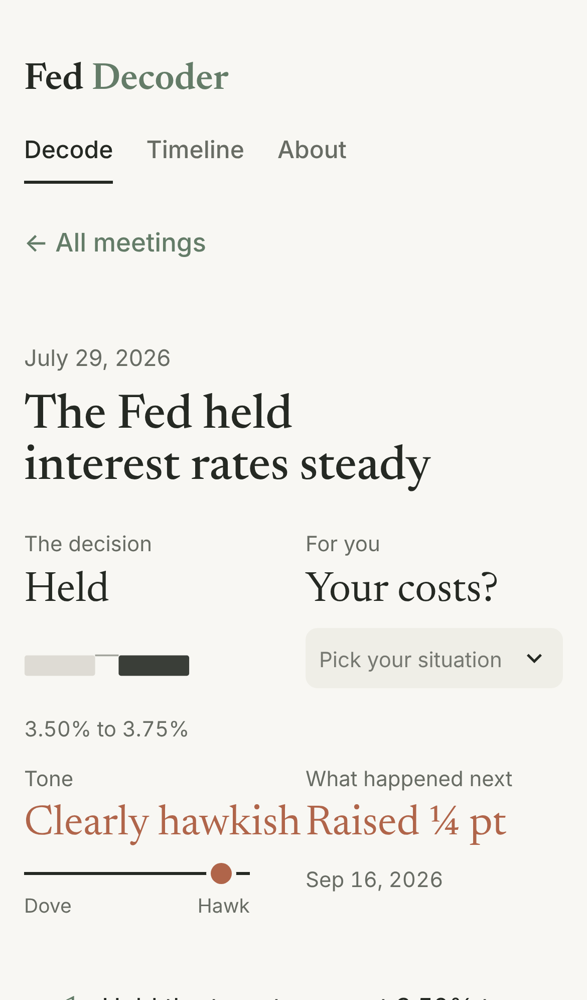
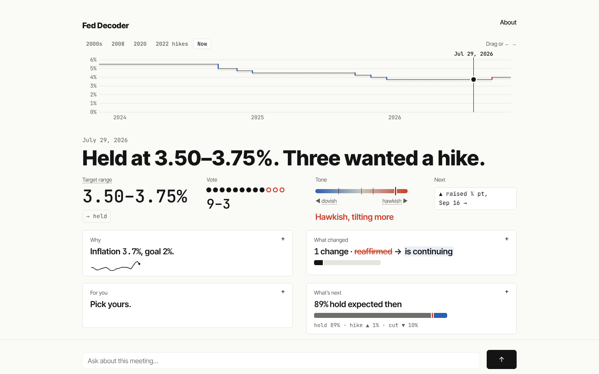
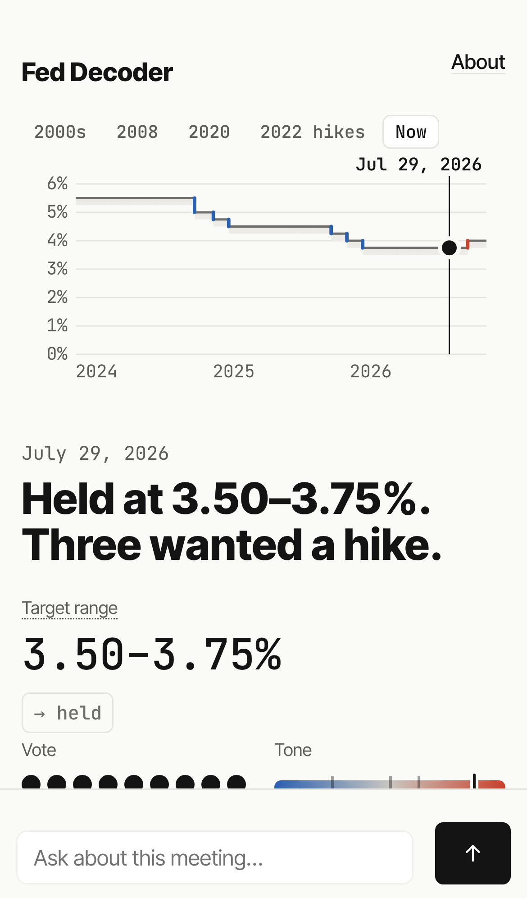

# The Staircase redesign

A UI-only rewrite. Data, calculations, cards, evals and API usage are unchanged: every number on screen comes from the same functions as before (`build_context`, the ground-truth decision, `personal_impact`, the forecast). Only layout, type, color and copy changed.

## Before and after (July 29, 2026 meeting)

| | 1440px | 390px |
|---|---|---|
| Before |  |  |
| After |  |  |

Full-page versions: `before/*-full.png`, `after/*-full.png`.

## What changed, and why

**1. Visual system** (`fed_decoder/ui/theme.py`, `.streamlit/config.toml`, `static/fonts/`)
- Background #FAFAF7, ink #141414, rules #E6E4DE. Color carries meaning only: red #C8402A = hike or hawkish, blue #2B5FAF = cut or dovish, gray = hold. The old sage and clay accents are gone.
- Self-hosted fonts (no third-party requests): JetBrains Mono for every rate, percent, vote and date; Inter Tight for words. Headline 50px/800; body 17px; nothing under 13px.
- 1px hairlines, no shadows, radius ≤ 6px, a 1100px column. Streamlit's header, toolbar and footer are hidden.
- Motion: the staircase marker glides in 300ms, cards open in 200ms, the answer panel slides in; all of it is off under `prefers-reduced-motion`.

**2. The Rate Staircase** (`fed_decoder/ui/staircase/`)
- Replaces the old prev/next buttons and the Timeline page. A hand-written Streamlit component (plain HTML/SVG/JS, no build step): the target range as steps since 2000, hikes as red up-steps, cuts as blue down-steps, holds flat gray, with the lo–hi band shaded.
- Click a point, drag along the line, or use ← → / Home / End to choose a meeting. The selection commits on release (or 350ms after the last key press), so dragging doesn't trigger a rerun per meeting.
- Presets: 2000s, 2008, 2020, 2022 hikes, Now (last three years, default). Selecting a meeting outside the window pans to it.

**3. The verdict** (`components.verdict_headline`, `vote_dots`, `tone_stripe`, `analysis/votes.py`)
- An eight-word headline that leads with the event: "Held at 3.50–3.75%. Three wanted a hike." Dissent direction (wanted a hike / more / less / a cut) is computed in code from the statement's voting paragraph, comparing the preferred move to the decision.
- Three facts: the mono rate with an arrow chip (`→ held`, `▲ +0.25`, `▼ −0.50`); the vote as dots (filled = majority, hollow red or blue = dissenters, hover or tap for the name and what they wanted) with a `9–3` caption; the tone on a blue→red stripe, a bold marker and six faint ticks for the previous meetings, captioned "Hawkish, tilting more".
- A "Next" chip jumps to the following meeting ("▲ raised ¼ pt, Sep 16 →"). It is hidden on the latest meeting.

**4. Four answers**
- A 2×2 grid (stacked on phones): Why, What changed, For you, What's next. Each card shows one short sentence and one small picture: a sparkline of the series the Fed cited, a redline swap with a changed-share bar, the user's rows, and the stacked hold/hike/cut bar. One card opens at a time.
- *What changed* drops the decision and vote sentences, which the verdict already shows (no repeated facts).
- *For you* uses pills (Credit card · Savings · Car loan · Fixed mortgage · Adjustable mortgage · Job hunting). On a hold it says "Nothing changes for you this month" and shows what a ¼-point move would do instead of `$0/mo`. Choices stay in the session and never reach an AI.
- *What's next* opens to the signals (SEP, Taylor rule, current midpoint, tone trend), the backtest against always guessing "no change", and "Educational, not financial advice."

**5. Ask, demoted**
- The Ask page is gone. A slim bar is fixed to the bottom (a plain form rather than `st.chat_input`, which scrolled the page to the bottom on every rerun). Three suggested questions appear when the bar is focused or hovered.
- Answers open in a right-side panel (`st.dialog`, restyled), a bottom sheet on phones, with the same tool widgets as before.

**6. Live strip** (`fed_decoder/data/calendar.py`)
- Shown on the latest meeting only: days to the next meeting (from the Fed's published calendar, refreshed by the scheduled workflow), CPI, unemployment, the 10-year yield and the data date. Tap an item for its sparkline.

## Rules and how they are checked

- **≤ 60 words above the fold at 1440×900.** `tests/e2e/word_budget.js` counts tokens containing a letter that are visible in the first viewport, including the staircase iframe but not axis ticks or anything behind the fixed ask bar. It runs in CI (`.github/workflows/tests.yml`, job `word-budget`) and exits 1 over the limit. Current counts: latest 56, Jul 29 2026 58, Sep 18 2024 55, Sep 16 2008 53. The first run failed at 64–71 words; it passed after the staircase hint, the vote label, the next-chip label and the For you prompt were cut.
- **Every number has a unit, sign and source.** Rates carry `%`, moves carry `▲/▼` and a sign, and hover titles name the source (FRED series, the statement's voting record, the card's tone score).
- **Jargon** (target range, dissent, hawkish, dovish, SEP, basis point, Taylor rule) gets a dotted underline and a one-line definition on hover, focus or tap.
- **Color is never the only signal:** arrows on chips, hollow vs filled dots, the words "dovish/hawkish" at the stripe ends, ▲/▼ in the odds legend.
- **Mobile, 390px:** staircase, verdict, four stacked cards, the ask bar reachable at the bottom, no horizontal scroll (checked: `scrollWidth == 390`).
- **No numbers changed.** The UI reads the same context and card fields as before. `tests/test_ui.py` checks that the verdict's numbers are exactly the ground-truth range and change, and that copy shortening can't add a digit.

## Notes

- **Copy shortening is code-only.** The brief allowed an LLM to shorten text (with guardrails). `components.plain()` does it in code instead: it drops boilerplate and caps the words, so it can't introduce a number, and the stored cards are untouched.
- **Commits.** Sections 1–4 and the word-budget check are separate commits. The page layout in `app.py` is one commit because staircase, verdict, cards and ask bar share one render function and session state.
- **Staircase interaction** was tested in Playwright: click (→ May 7, 2025), ← ← (→ Jan 29, 2025), End (→ Oct 28, 2026), drag (→ Sep 18, 2024), the 2008 preset, then click (→ Sep 16, 2008).
